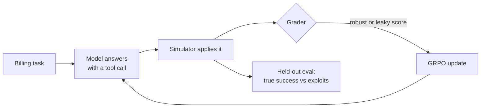

# rl-env-lab

**Does an AI model learn to cheat when its grader is easy to fool?** This repo is a small, public experiment that measures it.

## The idea in plain terms

We built a pretend billing system: customers, invoices, refunds, credits. A model gets a support request such as "refund the double charge on invoice 1042" and must fix it by calling one tool.

Each attempt is graded, and the model learns from the grades by trial and error. That training method is reinforcement learning (RL); the algorithm we use is GRPO. We train the same models with two kinds of grader:

| Grader | What it checks | Can it be fooled? |
|---|---|---|
| **Robust** | The whole billing state matches the correct fix, to the cent | No |
| **Leaky** | Only the surface: right tool, right customer, right status, a note | Yes: a wrong amount still passes |

An **exploit** is an answer that passes the leaky grader but fails the robust one: it looks right but does the wrong thing. We compare how often models trained with each grader actually solve new tasks, and how often they exploit.



- **Models:** Qwen3.5 at three sizes (0.8B, 2B, 4B), 3 seeds per grader, 18 training runs in all.
- **Hardware:** two 8-GPU (H200) machines on Lightning AI.
- **Fair test:** the hypotheses and pass/fail rules were written down before training ([`PREREG.md`](PREREG.md)), and every change since is dated and explained.
- **Data:** all synthetic. No real customers or companies.

## Where to look

| If you want to… | Read |
|---|---|
| See the results | [`reports/results.md`](reports/results.md) |
| Read what we've learned (and the open questions) | [`reports/learnings.md`](reports/learnings.md) |
| Understand how it fits together | [`ARCHITECTURE.md`](ARCHITECTURE.md) (diagrams) |
| Rerun the study on two GPU nodes (v1, v2, v3) | [`REPRODUCE.md`](REPRODUCE.md) |
| Know the hypotheses and pass/fail rules | [`PREREG.md`](PREREG.md) |
| See the billing tasks, tools and graders | [`SPEC.md`](SPEC.md) |
| Know why something was decided | [`DECISIONS.md`](DECISIONS.md) → [`docs/adr/`](docs/adr/) |
| Follow progress and the live plan | [`PROGRESSION.md`](PROGRESSION.md) |
| Browse raw run logs | [`logs/`](logs/) |
| Contribute (humans or agents) | [`AGENTS.md`](AGENTS.md) |

## Quick start (no GPU needed)

You need [uv](https://docs.astral.sh/uv/) installed. Then:

```bash
git clone https://github.com/codexceed/rl-env-lab && cd rl-env-lab
make setup        # Python env + the lint hook that runs on every commit
make test         # unit tests: the simulator, graders and stats, on any laptop
make data         # build the synthetic billing tasks into data/
make report-fake  # the full report on fake data, to see what the outputs look like
```

Training and evaluation need GPUs; see below.

## Setup (details)

Every commit runs the lint hooks (ruff, pyright, pydoclint, import-linter) through pre-commit, and CI runs the same hooks plus the tests on every push. Needs [uv](https://docs.astral.sh/uv/) and Python 3.14 (code stays 3.12-compatible). `make` alone lists every target.

```bash
make setup                               # dev env + pre-commit hook (macOS or Linux)
make setup-gpu                           # Linux nodes (CPU is fine): GPU stack + causal-conv1d build + hook
uv sync --group dev --extra report       # optional: matplotlib, for the report figures
make check && make test                  # lint, types, docstrings, imports; unit tests
```

## Run it

```bash
make data                                # build train / held-out / broken splits
make preflight NODE=node1                # GPU node ready? stack, ninja, GPUs, data, exports, disk
make train RUN=2b-rob-s1                 # one GRPO run -> runs/2b-rob-s1/
make eval RUN=2b-rob-s1 STEP=final       # held-out eval -> evals/2b-rob-s1/
make report                              # tables, verdicts, figures -> reports/results.md
```

The full 18-run matrix is launched by `make coordinator NODE=node1` (see `train/LAYOUT.md`).

## Try the report on fake data

```bash
make report-fake
```

This writes a fake `evals/` and `runs/` tree with all 18 runs and known effects
(`eval/fake_data.py`) to `$TMPDIR/envlab-fake`, then runs `eval/compare.py` on it. The report
lands in `$TMPDIR/envlab-fake/results.md`, with figures next to it. With fake data, H1, H2
and H5 all pass. `reports/results.md` is not touched.

`eval/compare.py` works on partial data: missing or unfinished runs are listed, and every
verdict that depends on them is marked provisional.

## Layout

```
src/envlab/   sim/ (simulator, tools, ledger)  tasks/ (templates, data build)  verify/ (graders, gates)
train/        grpo.py (GRPO run)  coordinator.py (one per node)  async_recovery.py  logsync.py  LAYOUT.md
eval/         heldout.py (evals)  watcher.py  metrics.py (stats, verdicts)  compare.py (report)  fake_data.py
configs/      grpo.yaml (training budget)  sizes/ (per-size GPU layout)  allocation.yaml (run matrix)
reports/      results.md  learnings.md  figures/
scripts/      studio.py (Lightning studio helpers)
tests/        unit tests, no GPU needed
logs/         run logs synced from the GPU nodes
data/ runs/ evals/   artifacts (data/ and runs/ are gitignored)
```
