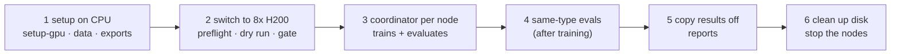

# REPRODUCE

How to rerun the study's three project versions on two 8x H200 nodes, without the hiccups we hit. Background: `README.md` (the idea), `ARCHITECTURE.md` (how it fits together), `reports/learnings.md` (what went wrong and why).

| Version | Tasks | Settings | Runs | Status |
|---|---|---|---|---|
| **v1** | `SPEC.md` | thinking off, answer cap 256 | 0.8B / 2B / 4B × robust, leaky × 3 seeds = 18 | pre-registered (`PREREG.md`) |
| **v2** | same as v1 | thinking on, cap 1,024 (`--variant v2-think`) | 2B, 0.8B × 2 rewards × 3 seeds = 12 | exploratory (ADR 0005, 0006) |
| **v3** | `SPEC_v3.md`, `data/v3` | thinking on, cap 1,024 (`--variant v3`) | 4B, 2B × 2 rewards × 3 seeds = 12 | exploratory (ADR 0007) |

Each version has its own two-node plan: `configs/replicate/v1.yaml`, `v2.yaml`, `v3.yaml`. (`configs/allocation.yaml` records how the study actually ran: versions chained on one node, the other reshaped mid-study. Don't copy it.)



---

## 1. What you get and what it costs

**Per version** (run times measured in `logs/runs/*/status.json`; node wall clock is this plan's layout; [rate] per 8x H200 node):

| Version | Run time per run | Training GPU-hours | Node wall clock (node1 · node2) | Node-hours* | Cost* |
|---|---|---|---|---|---|
| v1 | 0.8B 1.3–1.6 h, 2B 2.9–3.5 h (1 GPU); 4B 1.3–1.5 h (4 GPUs) | 61 | ~6.3 h · ~5.5 h | ~15 | [cost] |
| v2 | 0.8B 2.1–2.6 h, 2B 2.7–3.5 h (1 GPU) | 34 | ~3.5 h · ~2.6 h | ~9 | [cost] |
| v3 | 4B 2.3–3.0 h (4 GPUs), 2B 3.5–4.2 h (1 GPU) | 90 | ~8.4 h · ~8.4 h | ~20 | [cost] |
| **All three** | | **185** | | **~44** | [cost] |

\* Estimate: training wall clock plus ~1.5 h per node for preflight, dry run, gate or base evals and the eval tail. Setup on a CPU machine is extra but cheap. For comparison, our whole study took ~41 node-hours ([cost]) with the versions chained, ~3 h of it lost to restarts (learnings §5).

v1's 2B and 0.8B times were measured with the old synchronous checkpoint saves; recovery saves are asynchronous now, so expect them a little faster.

**Evals** run on GPU 6–7 of each node while training runs, plus any GPU no remaining run needs.

| Version | Held-out checkpoints | Time per eval |
|---|---|---|
| v1 | 18 runs × 20 + 3 base models = 363 | ~1 min (1,000 samples, cap 256) |
| v2 | 12 × 20 = 240 | longer (answers ~4× longer); not measured on its own |
| v3 | 12 × 10 + 2 base models = 122 | 4B ~6 min (4,000 samples) |
| same-type (all) | 1 per run at its final step + the base models | similar to held-out |

**Disk**, per node:

| Item | Size | How many |
|---|---|---|
| Recovery checkpoint (full trainer state) | 22 GB (2B), 55 GB (4B) | last 2 per running run; deleted after the run's final integrity check |
| Eval weights (bf16, ~2 bytes per parameter; 4B ~9 GB) | per eval step | 20 per run (v1, v2), 10 (v3); never deleted automatically |
| Peak | ~1–1.5 TB for one version (estimate); **~4 TB** when we chained all versions on one node | |

At the end, keep the final (and peak, §6) checkpoints and delete the rest: we went from ~4 TB per node to 310 GB across both (§5, "Clean up").

---

## 2. Setup (per node)

We used Lightning AI studios (`bare-metal`, 8x H200). Any Linux 8x H200 box works; skip the studio rows.

| Step | Command | Why / watch out |
|---|---|---|
| Studio on **CPU**, auto-sleep off | `make studio-status STUDIO=<name>` (from a laptop; shows machine and auto-sleep) | Setup needs no GPU; don't pay GPU rates for it. Turn auto-sleep off in the studio settings. `scripts/studio.py` hard-codes our org and teamspace: edit `ORG` / `TEAMSPACE` |
| Clone, same commit on both nodes | `git clone <your fork> rl-env-lab && cd rl-env-lab` | Matched pairs record the git commit (`run_manifest.json`) |
| Shell hygiene | `unset UV_LIGHTNING_VIRTUALENV_ROOT; source .venv/bin/activate` (after the next step) | Studios redirect uv envs; the venv's `bin/` on PATH gives vLLM its `ninja` |
| GPU stack | `make setup-gpu` | Builds `causal-conv1d` with a pip CUDA nvcc (no GPU needed), runs the tests at the end. **Never plain `uv sync` on a node**: it drops the `gpu` extra |
| Data, v1 and v2 | `make data && make acceptance`, then `git status --short data/` must be empty | Rebuilds the frozen splits; must match the committed manifests. Only on a node with nothing running: runs read `data/` and its hash is part of every run's identity |
| Data, v3 | `make data-v3 && make acceptance-v3` | Writes `data/v3` only; v1 files untouched |
| Data added later | `make data-sametype` | Safe while runs read `data/` |
| Text-only model exports | `uv run python -m train.export_text --model Qwen/Qwen3.5-2B` (each size the version uses) | Runs export on first use too, but six runs would then wait on one export lock |
| Switch to GPUs | `make studio-switch STUDIO=<name> MACHINE=H200_X_8` (from a laptop) | |
| Preflight | `make preflight NODE=<node>` | Checks GPU stack imports, `ninja`, GPU count, data vs manifest, model exports, disk. The coordinator runs it at startup too, unless `--skip-preflight` |

---

## 3. Run each version

Both nodes run the same steps with their own `--node`. Start the coordinator in the background; it is restart-safe (it re-reads every `status.json` and adopts live runs), it supervises the eval watcher, and it never stops the machine.

```bash
# every node, every version: print the plan first, then launch
# (same via make: make plan NODE=node1 CONFIG=configs/replicate/vN.yaml; make coordinator ...)
uv run python train/coordinator.py --config configs/replicate/vN.yaml --node node1 --print-plan
mkdir -p runs/_coordinator
nohup uv run python train/coordinator.py --config configs/replicate/vN.yaml --node node1 \
  >> runs/_coordinator/node1.out 2>&1 &
nohup make logsync NODE=n1 >> runs/_coordinator/logsync-n1.out 2>&1 &   # optional: small files to logs/, pushed to your fork's main
```

Done when `runs/_coordinator/<node>.idle` exists: every run finished and every eval checkpoint evaluated. Progress: `runs/_coordinator/<node>.jsonl`, `runs/<run_id>/status.json`, `evals/<run_id>/`.

### Layouts

| Version | Node | GPU 0–3 | GPU 4 | GPU 5 | GPU 6–7 |
|---|---|---|---|---|---|
| v1 | node1 | 2B ×4 (1 GPU each), then 4B seed 3 rob → leak | 2B, then eval | 2B, then eval | eval |
| | node2 | 4B seeds 1–2: rob, leak, rob, leak | 0.8B rob s1 → s2 → s3 | 0.8B leak s1 → s2 → s3 | eval |
| v2 | node1 | v2 2B ×4 | v2 2B | v2 2B | eval |
| | node2 | v2 0.8B ×4 | v2 0.8B | v2 0.8B | eval |
| v3 | node1 | v3 4B: rob s1, leak s1, rob s2 | v3 2B rob s1, then eval | v3 2B leak s1, then eval | eval |
| | node2 | v3 4B: leak s2, rob s3, leak s3 | v3 2B rob s2 → s3 | v3 2B leak s2 → s3 | eval |

### Before launch, per version

| Version | node1 | node2 | Pass when |
|---|---|---|---|
| v1 | `make dry-run` (12 steps: 2B rob + leak, 4B rob, two resumes) | `make base-evals` (band check + base held-out, 3 sizes) | `DRY_RUNS_EXIT 0`; base numbers near §4 |
| v2 | `make diagnostic SIZE=2b && make diagnostic-think SIZE=2b`; `DRY_V2=1 make dry-run` | `make diagnostic SIZE=0.8b && make diagnostic-think SIZE=0.8b` | `go_no_go.verdict` is `go` in `evals/diagnostic/base-<size>_think_step-00000.summary.json` |
| v3 | `make diagnostic-v3 SIZE=4b`; `make dry-v3` | `make diagnostic-v3 SIZE=2b` | `v3_gate.verdict` is `go` in `evals/diagnostic/v3-base-<size>_step-00000.summary.json`; `DRY_V3_EXIT 0` |

Run these before the coordinator: they use GPUs the plan trains on. The thinking-off diagnostic must come first in v2: the go/no-go compares against it. (Our committed `base-0.8b_think` summary says `no-go`: it predates the fix that compares only templates both diagnostics share, learnings §3. The current code says `go`.)

### Evals

- **Held-out**: automatic. The watcher evaluates every checkpoint as it lands (final first, then every 100 steps), with each run's own settings (variant, thinking, cap, data dir).
- **Base models**: scheduled by the watcher too. Without that, run them by hand: v1 `make eval-base SIZE=<size>`; v3 `uv run python eval/heldout.py --size <size> --checkpoint base --variant v3` (run id `v3-base-<size>`).
- **Same-type** (exploratory), once the node is idle: `uv run python eval/sametype_batch.py --gpus 0,1,2,3,4,5,6,7 --final-only`. It brings the base models; drop `--final-only` to evaluate every checkpoint (10–20× the work).

### Reports

Copy both nodes' results to one machine (§5, "Results off the node"), then:

| Version | Command | Writes |
|---|---|---|
| v1 | `make report` | `reports/results.md` (verdicts, figures) |
| v2 | `make v2-report` | `reports/v2.md` |
| v3 | `make v3-report` | `reports/v3.md` |
| same-type | `make sametype-report` | `reports/sametype.md` |

Figures need matplotlib: on a laptop, `uv sync --group dev --extra report`. Never on a node (drops the `gpu` extra).

---

## 4. Expected results

Runs are **not bit-reproducible**: vLLM sampling differs run to run even with fixed seeds. Judge a replication by the 3-seed means and the spread below, not by single numbers. **One seed in three can fail to transfer**: we saw it at v1 4B robust (s2) and v2 0.8B robust (s1).

You can rebuild every number below from the committed logs, no GPU needed: `uv run python eval/compare.py --evals logs/evals --runs logs/runs --stdout` (same numbers; verdicts show as provisional because `logs/` holds no checkpoint markers), `uv run python eval/v2_report.py --evals logs/evals --out -`, `uv run python eval/v3_report.py --evals logs/evals --runs logs/runs --out -`.

### v1 (pre-registered, final step 1,000, held-out)

| Size | Base true / exploit | Robust true: seeds → mean | Leaky true: seeds → mean | Leaky exploit |
|---|---|---|---|---|
| 0.8B | 21.5% / 41.1% | 24.7, 34.2, 28.9 → **29.3%** | 26.4, 28.6, 26.0 → **27.0%** | 72.7% |
| 2B | 21.8% / 48.3% | 41.5, 34.4, 34.0 → **36.6%** | 30.4, 22.9, 27.3 → **26.9%** | 63.9% |
| 4B | 29.7% / 57.0% | 55.7, **36.9**, 57.9 → **50.2%** | 27.9, 29.6, 27.8 → **28.4%** | 64.5% |

| Verdict | Ours | Watch for |
|---|---|---|
| H1, environment teaches | **PASS**: +14.8 pts, CI +9.7 to +20.8 | robust |
| H2, leaky reward misleads | **FAIL by 0.2 pts**: drop +9.8 (CI +5.4 to +14.0) vs a 10-pt bar | can land on either side of the bar in a rerun |
| H5, bigger models exploit more | **FAIL**: 72.7 / 63.9 / 64.5% | flat, not rising |

### v2 (exploratory, final step, held-out)

| Size, reward | True success: seeds → mean | Exploit |
|---|---|---|
| 2B robust | 73.0, 70.5, 74.4 → **72.6%** | 21.3% |
| 2B leaky | 27.0, 24.4, 19.8 → **23.7%** | 74.0% |
| 0.8B robust | **18.8**, 59.4, 59.6 → **45.9%** | 27.5% |
| 0.8B leaky | 24.3, 27.4, 28.2 → **26.6%** | 67.6% |

### v3 (exploratory, final step, held-out near / far)

| Model | Near true (seed range) | Far true (seed range) | Near exploit |
|---|---|---|---|
| 4B base | 56.7% | 62.9% | 15.7% |
| 4B robust | **72.8%** (52–88) | **75.2%** (63–82) | 10.8% |
| 4B leaky | **28.4%** (13–37) | **29.2%** (10–46) | 68.5% |
| 2B base | 18.9% | 19.1% | 20.1% |
| 2B robust | **47.6%** (38–57) | **31.5%** (16–43) | 36.5% |
| 2B leaky | **18.5%** (17–20) | **11.6%** (7–15) | 79.5% |

Headline to reproduce: on v3, leaky training leaves 4B *below* its untrained base (−28 / −34 pts), and the robust − leaky gap is ~+45 pts at 4B. Full tables: `reports/results.md`, `reports/v2.md`, `reports/v3.md`.

---

## 5. Known pitfalls and fixes

| Symptom | Cause | Fix |
|---|---|---|
| After a studio restart: `ModuleNotFoundError` deep in torch, imports taking minutes | A stop wipes uv's package cache on the system disk; the venv's files are links into it | `make setup-gpu` (~55 min on a cold disk). Preflight catches it |
| GPU packages vanish | Plain `uv sync` on a node drops the `gpu` extra | Only `make setup-gpu` (it runs `uv sync --group dev --extra gpu --inexact`) |
| Every eval fails at generation | vLLM's compiler needs `ninja` from the venv; `.venv/bin/python` alone doesn't put it on PATH | Fixed in code: `eval/heldout.py` and `train/grpo.py` put the venv's `bin/` first on PATH at startup. `make preflight` checks `ninja` |
| uv uses the wrong environment | Studios set `UV_LIGHTNING_VIRTUALENV_ROOT` | `unset UV_LIGHTNING_VIRTUALENV_ROOT` (the Makefile and scripts do) |
| Node B can't see node A's new files; downloads 404 | The cross-studio mount works one way in practice, and a busy studio's writes reach shared storage late | Don't rely on the mount for results. Stream them back through the studio command channel, or wait until the studio stops; `make logsync` mirrors the small files through git |
| Disk "full" or "empty" on the dashboard | The dashboard figure lags by hours | Trust `du -sh runs evals` |
| An eval and an ad-hoc job collide on one GPU | The watcher claims GPUs within seconds | Pause the watcher first: run ad-hoc GPU jobs only once the node is idle, or on GPUs outside its lease (`runs/_coordinator/<node>.eval_gpus.json`) |
| Training stalls 10–15 min at every save | 22–55 GB checkpoints, six runs, one network disk | Handled: async recovery (`checkpoints.async_recovery: true`), 4B every 100 steps. A busy writer skips one save |
| Checkpoints pile up waiting for evals | All 8 GPUs training | Keep GPU 6–7 for eval (the replicate configs do; a test enforces it) |
| Plan runs out of time or money | Evals and base evals left out of the budget | Use §1: evals, gates and the tail are ~1.5 h per node |
| Deadline fires at the wrong hour | Node clocks run on UTC | Write `node_hard_deadline` with an offset |
| A run's identity changes mid-study | Rebuilt or edited frozen data (`manifest.json` hash) | New splits go in their own manifest (`make data-sametype`, `make data-v3`) |

**Results off the node.** Before any cleanup, copy everything except weights: `evals/` (records, traces, `sametype/`), and per run `status.json`, `run_manifest.json`, `train_config.json`, `train_metrics.jsonl`, `recovery_events.jsonl`, `eval/step-*/COMPLETE`. Example: `tar czf results-node1.tgz --exclude='*.safetensors' --exclude='*.bin' --exclude='*.pt' --exclude='recovery' --exclude='models' runs evals`, then fetch it once the node is quiet.

**Clean up.** With results copied: `make cleanup-plan` (shows what it would delete), then `uv run python scripts/cleanup_node.py --apply`. Keep final checkpoints and the mid-run peaks (§6). Then stop the nodes; the coordinator never does.

---

## 6. Method notes for anyone extending it

| Note | Evidence | Pointer |
|---|---|---|
| **Held-out transfer peaks mid-run, then decays** while training reward holds | v1 4B robust s1 / s3 ~0.85 at steps 200–450 vs 0.56–0.58 at 1,000; v3 4B robust 87% / 89% at step 400 vs 73% / 75% final | Verdicts use the final step (pre-registered). Picking a peak on held-out data selects on the test set; a validation split would fix that ([ADR 0008](docs/adr/0008-validation-split-and-answer-budget.md), proposed). Keep peak checkpoints when cleaning up |
| **2B's answer budget is tight in v3** | 41% of v3 2B base answers hit the 1,024-token cap mid-thought (4B: 19%) | ADR 0006 (why 1,024), ADR 0007; ADR 0008 proposes one cap sized for the smallest model (~2,048 on v3 tasks) |
| **Task difficulty must be re-checked per size** after any change to how the model answers | Thinking on took 4B to 0.87 on v1 tasks (4 of 11 types in band), so v2 4B was dropped | ADR 0005, 0007; the gates in §3 |
| **Near vs far held-out** separates hacking from missing skill | Near templates only recombine trained steps, so a near exploit is hacking | `SPEC_v3.md`, ADR 0007 |
| **One budget for every size** | Same steps, prompts, generations, cap and LR across sizes (H5 validity); size files may change only the GPU layout and recovery interval | `configs/grpo.yaml`, ADR 0003 |
