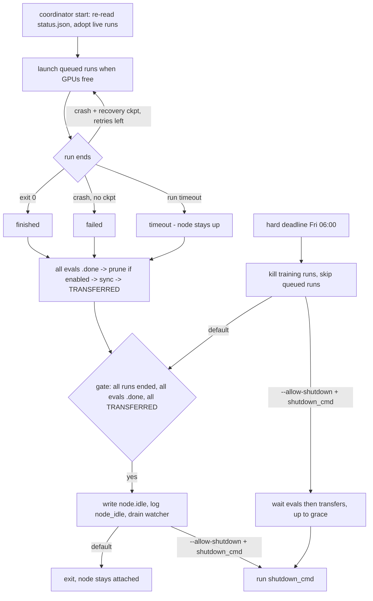

# Artifact layout and node lifecycle

This is the contract between the trainer (`train/grpo.py`), the eval script (`eval/heldout.py`), the eval watcher (`eval/watcher.py`) and the coordinator (`train/coordinator.py`). Path helpers live in `train/checkpoints.py`. Paths and commands come from `configs/allocation.yaml` (PROGRESSION §1.4).

## Layout

```
<runs>/<run_id>/
  status.json                  coordinator  running|finished|failed|timeout, start/end, exit code, attempts
  run_manifest.json            trainer      written at start: matched-pair identity (train/run_manifest.py)
  train_config.json            trainer      resolved settings, layout, package versions
  train_metrics.jsonl          trainer      one row per optimizer step
  recovery_events.jsonl        trainer      async recovery: one row per snapshot, write, skip or failure (seconds, bytes)
  eval/step-<NNNNN>/           trainer      eval weights, every 50 steps + the final step
    config.json, *.safetensors, tokenizer files
    COMPLETE                   trainer      written LAST: {"step": N, "final": bool, "files": [...]}
  recovery/checkpoint-<N>/     trainer      full state: model, optimizer, scheduler, RNG, trainer state
    COMPLETE                   trainer      written LAST
  recovery/.tmp-checkpoint-<N>/  trainer    async recovery only: staging, never a checkpoint
    checkpoint-<N>/            trainer      the checkpoint being written (same files as above, no COMPLETE)
    .rank-<K>.done | .failed   trainer      rank K's files are written and fsynced | its write failed
    .abandoned                 trainer      main rank gave up on this checkpoint (failure or timeout)
  logs/attempt-<k>.log|.exit   coordinator  output and exit code of each launch
  TRANSFERRED                  coordinator  sync command succeeded: {"ts", "eval_steps_done": [...]}

<runs>/_coordinator/
  <node>.jsonl                 coordinator  append-only event log
  <node>.idle                  coordinator  gate passed: "node idle, safe to release"
  <node>.eval_gpus.json        coordinator  GPU lease for the watcher: {"gen", "gpus", "drain"}
  <node>.watcher.json          watcher      state + lease ack: {"pid", "ack_gen", "busy"}

<evals>/<run_id>/
  step-<NNNNN>.jsonl           eval script  per-sample results (SPEC §12 records; the metrics read only this)
  step-<NNNNN>.traces.jsonl    eval script  per-sample traces: the record + completion, parsed call, grader reasons
  step-<NNNNN>.done            watcher      eval succeeded
  step-<NNNNN>.failed          watcher      retries exhausted (blocks the gate; needs a human)
  step-<NNNNN>.claim           watcher      lock, so two watchers never evaluate the same step
  logs/                        watcher      eval logs
  sametype/step-<NNNNN>.jsonl  sametype_batch  EXPLORATORY (ADR 0005): same-type eval records (+ .traces.jsonl, logs/);
                                               a subdirectory, so metrics, compare and logsync never read it

<evals>/diagnostic/
  <run>_step-<NNNNN>.jsonl     eval script  diagnostic baseline (+ .summary.json); `_think_` in the name = thinking on
```

**Rules**

| Rule | Detail |
|---|---|
| Step names | `NNNNN` is zero-padded to 5 digits: `step-00050`. |
| `COMPLETE` last | A directory without `COMPLETE` is in progress, and every consumer ignores it. |
| Final step | `COMPLETE` with `"final": true`. It need not be a multiple of 50. |
| Never deleted | Nothing under `eval/` or `<evals>/`. The watcher never deletes anything; it releases locks by renaming them. |
| Pruning | Only complete `recovery/checkpoint-<N>` dirs are pruned, keeping the newest `keep_last` (2). Everything needs `checkpoints.pruning_enabled: true`, which stays off until resume is verified. **During training** the trainer rolls them (`train/callbacks.py`): an older one is deleted only once a newer one has `COMPLETE`. **After the run** the coordinator removes the rest, once the final eval step passes the integrity check. `eval/` is never touched. |
| Async recovery | With `checkpoints.async_recovery: true` (default) see "Asynchronous recovery checkpoints" below. Consumers change nothing: only `recovery/checkpoint-<N>` with `COMPLETE` counts, and `.tmp-checkpoint-<N>` never matches `checkpoint-<N>`. |
| Integrity check | The final step has `COMPLETE`, every file listed in `files` exists and is non-empty, and each glob in `required_eval_files` (`config.json`, `*.safetensors`) matches a non-empty file. |

## Asynchronous recovery checkpoints

`checkpoints.async_recovery: true` in `configs/grpo.yaml` (`train/async_recovery.py`). Eval weights are unchanged (synchronous, every 50 steps). With `false` the Trainer writes recovery checkpoints synchronously as before.

```mermaid
sequenceDiagram
    participant T as training thread (every rank)
    participant W as writer thread (every rank)
    participant M as writer thread (main rank)
    T->>T: save step: any rank still writing? (all_reduce)
    alt a write is in flight
        T->>T: skip this checkpoint on all ranks, log recovery_skipped
    else idle
        T->>T: stock _save_checkpoint into .tmp-checkpoint-N/checkpoint-N/<br/>small files now; torch.save / safetensors copied to CPU and queued
        T->>W: start; training continues
        W->>W: write queued files, fsync, write .rank-K.done
        M->>M: wait for every .rank-K.done (1 h timeout)
        M->>M: fsync, rename to recovery/checkpoint-N, write COMPLETE, rolling prune, delete staging dir
    end
```

| Rule | Detail |
|---|---|
| Same files | The stock HF / TRL / DeepSpeed save code runs, only `torch.save` and safetensors `save_file` are deferred, so `checkpoint-<N>` holds exactly the synchronous files (`--resume-from` and `trainer.train(resume_from_checkpoint=...)` unchanged). Tensors are stored as CPU tensors. |
| `COMPLETE` timing | Written by the main rank's writer thread, after every rank's `.rank-<K>.done` and the rename. Same content as the synchronous marker: `{"step", "run_id", "size", "reward", "seed"}`. |
| Skipped checkpoints | A save step that finds a write still in flight on any rank is skipped everywhere (`recovery_skipped` in `recovery_events.jsonl`). The next save step tries again. So the newest complete checkpoint can be 100 steps old instead of 50. |
| Failures | A failed write (`.rank-<K>.failed`) or a 1 h wait leaves no `COMPLETE` (`.abandoned`, `recovery_failed`); training goes on. The staging dir is deleted before the next snapshot or at the next start (`remove_incomplete_recovery`). |
| Pruning | Rolling prune runs after the new `COMPLETE`, never before. |
| End of training | Every rank joins its writer (up to 3 h) before the final barrier; after a crash it waits up to 10 min, then the process exits. |
| Memory | At most one snapshot per rank. CPU buffers (pinned when CUDA is available) are reused: about the size of one checkpoint shard per process (2B: ~22 GB). |

## What each producer must do

**Trainer (`train/grpo.py`)**

- Accept the `commands.train` flags: `--run-id --size --reward --seed --gpus --output-dir`. For 4B, also `--vllm-server-gpus --train-gpus` (physical indices). On a crash relaunch the coordinator appends `--resume-from <recovery/checkpoint-N>`.
- Write eval weights to `eval/step-<NNNNN>/` every 50 steps and at the final step, then write `COMPLETE` last, with `"final": true` on the final step.
- Write recovery checkpoints to `recovery/checkpoint-<N>/` with `COMPLETE` last (asynchronously by default: staged under `recovery/.tmp-checkpoint-<N>/`, renamed, then `COMPLETE`). Roll them during training (keep the last 2) only when `pruning_enabled` is on; the coordinator cleans up after the run.
- At start (main rank, before training) write `run_manifest.json`. On a resume, keep the first manifest and append the start to `starts`; if anything that identifies the run changed, list it under that start's `mismatch`.
- Exit 0 on success, non-zero on failure. Never shut down the machine.
- `runs/<run_id>/` and `logs/` may already exist.

**`run_manifest.json`** lets `eval/compare.py` check that robust seed *k* and leaky seed *k* of one size stayed a matched pair (PREREG §1). Fields compared across a pair:

| Field | Value |
|---|---|
| `size`, `seed`, `max_steps` | from the resolved settings |
| `variant` | ADR 0005 config variant (`grpo.py --variant v2-think` or `v3`, ADR 0007), null for v1; also part of the config hash, so v2 / v3 never pair with v1 |
| `config_sha256` | sha256 of the resolved config without run id, reward, resume path and data path, plus the GPU-free layout (generation mode, training ranks, batch split) |
| `data` | train split sha256, sha256 of `data/manifest.json` (v3: `data/v3/manifest.json`), its `spec_version` |
| `base_model` | Hub id and a fingerprint of the text-only export (`config.json` and safetensors index hashes, weight file names and sizes) |

Recorded but not compared: `reward`, `reward_weights`, `git` (commit, dirty flag), paths. A pair that differs in a compared field, whose final eval steps differ, or with a resume `mismatch` is excluded from the verdicts and listed in the report.

**Eval script (`eval/heldout.py`)**

- Accept the `commands.eval` flags: `--run-id --size --reward --seed --checkpoint --step --output --gpus`.
- Write per-sample JSONL to `--output`, then exit 0. The watcher writes `.done` only on exit 0 with the output present.
- Write the trace file `<output stem>.traces.jsonl` next to it **before** the records file. Both are written to a temp file and renamed.
- Be safe to re-run: a retry overwrites a partial output.

**Trace rows** (`eval/heldout.py::trace_row`): one per (instance, sample), in the same order as the records. They feed the exploit gallery (`eval/gallery.py`) and audits. Metrics never read them.

| Key | Value |
|---|---|
| the 12 SPEC §12 keys | identical to the record |
| `completion` | decoded completion text (special tokens kept) |
| `call` | parsed tool call `{"name", "arguments"}`, or `null` on a parse failure |
| `parse_failure` | `{"reason", "detail"}` (`envlab.calls.ParseError`), or `null` |
| `tool_result` | `{"ok", "error", "message"}` from the simulator, or `null` on a parse failure |
| `robust`, `leaky` | `{"reason", "detail"}` from each grader; `reason` is `"ok"` on a pass |
| `exploit` | `leaky_pass and not robust_pass` |

## Node lifecycle



**Release policy:** Lightning Studio machines stay attached by default.

- When the gate passes, the coordinator only **reports** it. It writes `<node>.idle`, logs `node_idle` and exits.
- A shutdown command runs only with **both** `--allow-shutdown` and `coordinator.shutdown_cmd`. It never runs under `--dry-run`.
- The hard deadline is the **training cutoff**. It kills training runs, but it releases the node only under the same opt-in.
- Individual runs and the watcher never stop the machine.
- A coordinator restart deletes a stale `<node>.idle`.

**GPU sharing:**

- The watcher may only use GPUs in the lease. That is the node's `eval_gpus`, minus GPUs that training needs now, plus (with `lend_idle_gpus`) any GPU no remaining run will use.
- A training run starts only after the watcher has acked the lease that revokes its GPUs and has no eval still running on them.

**Reruns:** add a new run ID (e.g. `2b-rob-s1-r2`) to `runs` and to a group queue, then restart the coordinator. Finished runs are never relaunched.
